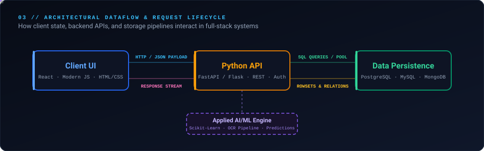

 

 

## 🪐 Technical Solar System

  

  

## ⚙️ How I Build: Full-Stack Request Lifecycle

  

## 🚀 Featured Projects

| Project | What It Does | Stack | Status |
| :--- | :--- | :--- | :--- |
| [**🌱 Crop Predictor**](https://github.com/Guruvesh03/Crop_Recommendation) | Agricultural recommendation system predicting optimal crop varieties based on soil nutrients (N, P, K), rainfall, and climate data. | `Python` · `Streamlit` · `Scikit-Learn` | [View Repo ↗](https://github.com/Guruvesh03/Crop_Recommendation) |
| [**📄 Summary Generator**](https://github.com/Guruvesh03) | Document vision pipeline utilizing optical character recognition (OCR) to ingest printed documentation and generate concise summaries. | `Python` · `Tesseract OCR` · `NLP` | [View Repo ↗](https://github.com/Guruvesh03) |
| [**🎓 Scholar Mentor**](https://github.com/Guruvesh03/EduTechAssistance) | Peer-to-peer student guidance and academic routing platform structuring curriculum roadmaps and milestone tracking. | `Python` · `REST API` · `Data Models` | [View Repo ↗](https://github.com/Guruvesh03/EduTechAssistance) |
| [**🧩 DSA in Java**](https://github.com/Guruvesh03/DSA-in-Java) | Algorithmic problem-solving repository with ~120 verified solutions covering core data structures and optimization techniques. | `Java` · `Algorithms` · `OOP` | [View Repo ↗](https://github.com/Guruvesh03/DSA-in-Java) |

## 🧩 Algorithmic Depth & DSA Telemetry

  

## 🧭 Engineering Journey

  

## 🎮 Contribution Activity

<a href="https://github.com/Guruvesh03">
<picture>
  <source media="(prefers-color-scheme: dark)"
          srcset="https://raw.githubusercontent.com/Guruvesh03/Guruvesh03/pacman-output/galaga-contribution-graph-dark.svg">
  <source media="(prefers-color-scheme: light)"
          srcset="https://raw.githubusercontent.com/Guruvesh03/Guruvesh03/pacman-output/galaga-contribution-graph.svg">
  
</picture>
</a>

## 🤝 Connect With Me

| Platform | Channel | Link |
| :--- | :--- | :--- |
| **GitHub** | Code repositories & open-source work | [@Guruvesh03](https://github.com/Guruvesh03) |
| **LinkedIn** | Professional network & career inquiries | [Guruvesh Bachhav](https://www.linkedin.com/in/guruvesh-bachhav-099538312/) |
| **Email** | Direct engineering communication | [guruveshbachhav@gmail.com](mailto:guruveshbachhav@gmail.com) |

 

  

