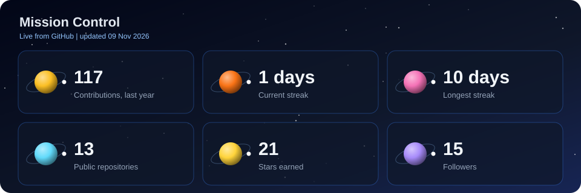

  

## 💻 About Me

## ⚡ Skills

## 🪐 My Language Solar System

## 🧭 My Journey

## 🧩 DSA Progress

## 🚀 Featured Projects

| Project | What it is | Stack |
|---|---|---|
| **Crop Predictor** | Crop recommendation app built during my AI/ML internship | Python, Streamlit |
| **Summary Generator** | OCR-based document summarizer | Python, OCR |
| **Scholar Mentor** | Student-focused mentoring platform | Python |

<!-- TODO: add a repo link for each project above once the code is public -->

### 🌌 Top Repositories

## 📡 Mission Control

## 🎮 Contribution Journey

<a href="https://github.com/Guruvesh03">
<picture>
  <source media="(prefers-color-scheme: dark)"
          srcset="https://raw.githubusercontent.com/Guruvesh03/Guruvesh03/pacman-output/galaga-contribution-graph-dark.svg">
  <source media="(prefers-color-scheme: light)"
          srcset="https://raw.githubusercontent.com/Guruvesh03/Guruvesh03/pacman-output/galaga-contribution-graph.svg">
  
</picture>
</a>

## 🌌 Currently Learning

- 🪐 Python backend (APIs, databases, deployment)
- 🪐 PostgreSQL and SQL
- 🪐 React (building on my basics)
- 🪐 Data Structures & Algorithms
- 🪐 Computer Networks and System Design fundamentals

## 🤝 Connect With Me

  

  
  
 <!--  -->

