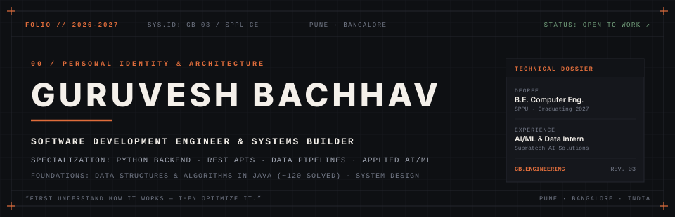
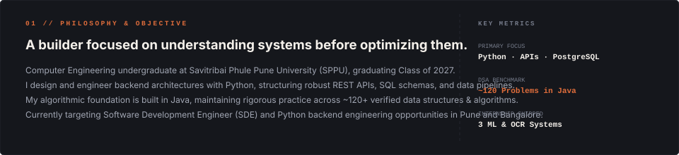
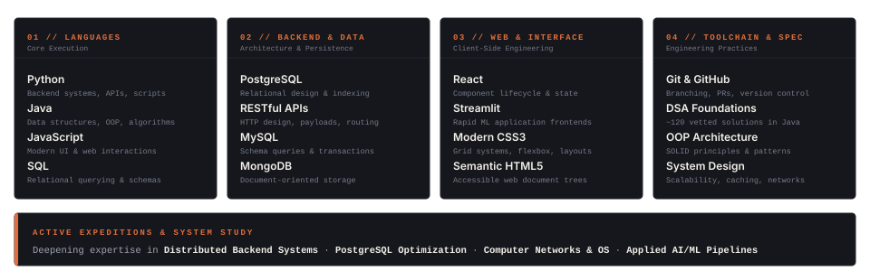
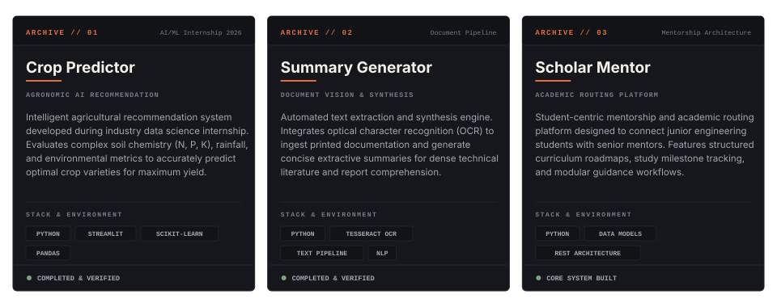
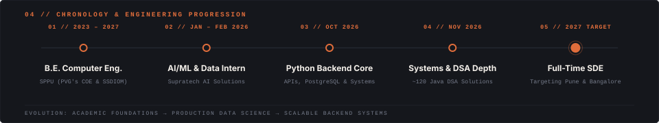
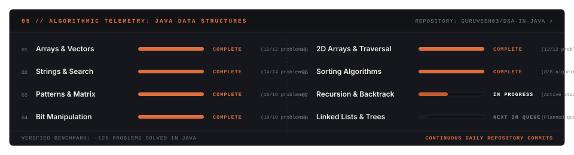
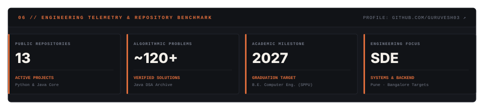
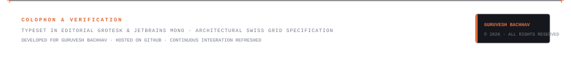

<!-- ═══════════════════════════════════════════════════════════════════
     GURUVESH BACHHAV — DIGITAL IDENTITY & SYSTEMS ARCHITECTURE
     Creative Direction: Swiss Editorial · Technical Notebook · Minimal Portfolio
     Color System: Warm Ivory (#F4F0EA) · Deep Charcoal (#0E1013) · Burnt Orange (#E06D3B)
     ═══════════════════════════════════════════════════════════════════ -->

<!-- ▌ 00 — EDITORIAL MASTHEAD -->

<picture>
  <source media="(prefers-color-scheme: dark)" srcset="assets/header-dark.svg">
  <source media="(prefers-color-scheme: light)" srcset="assets/header-light.svg">
  
</picture>

<!-- ▌ ACTIVE DISPATCH / STATUS -->

<picture>
  <source media="(prefers-color-scheme: dark)" srcset="assets/status-dark.svg">
  <source media="(prefers-color-scheme: light)" srcset="assets/status-light.svg">
  
</picture>

<!-- ▌ 01 — PHILOSOPHY & OBJECTIVE -->

<picture>
  <source media="(prefers-color-scheme: dark)" srcset="assets/about-dark.svg">
  <source media="(prefers-color-scheme: light)" srcset="assets/about-light.svg">
  
</picture>

<picture>
  <source media="(prefers-color-scheme: dark)" srcset="assets/divider-dark.svg">
  <source media="(prefers-color-scheme: light)" srcset="assets/divider-light.svg">
  
</picture>

<!-- ▌ 02 — TECHNICAL MATRIX -->

<picture>
  <source media="(prefers-color-scheme: dark)" srcset="assets/toolkit-dark.svg">
  <source media="(prefers-color-scheme: light)" srcset="assets/toolkit-light.svg">
  
</picture>

<picture>
  <source media="(prefers-color-scheme: dark)" srcset="assets/divider-dark.svg">
  <source media="(prefers-color-scheme: light)" srcset="assets/divider-light.svg">
  
</picture>

<!-- ▌ 03 — CURATED WORKS & DOSSIERS -->

<picture>
  <source media="(prefers-color-scheme: dark)" srcset="assets/projects-dark.svg">
  <source media="(prefers-color-scheme: light)" srcset="assets/projects-light.svg">
  
</picture>

| DOSSIER ID | REPOSITORY / ARTIFACT | STACK | STATUS |
| :--- | :--- | :--- | :--- |
| **`ARCHIVE // 01`** | [**Crop Predictor**](https://github.com/Guruvesh03/Crop_Recommendation) | Python · Streamlit · Scikit-Learn | Deployed Agronomic Model ↗ |
| **`ARCHIVE // 02`** | [**Summary Generator**](https://github.com/Guruvesh03) | Python · Tesseract OCR · NLP | Document Vision Synthesis ↗ |
| **`ARCHIVE // 03`** | [**Scholar Mentor**](https://github.com/Guruvesh03/EduTechAssistance) | Python · Data Models · REST Architecture | Peer Guidance Platform ↗ |
| **`FOUNDATIONS`** | [**DSA in Java**](https://github.com/Guruvesh03/DSA-in-Java) | Java · Data Structures · OOP | ~120 Algorithmic Solutions ↗ |

<picture>
  <source media="(prefers-color-scheme: dark)" srcset="assets/divider-dark.svg">
  <source media="(prefers-color-scheme: light)" srcset="assets/divider-light.svg">
  
</picture>

<!-- ▌ 04 — CHRONOLOGY & PROGRESSION -->

<picture>
  <source media="(prefers-color-scheme: dark)" srcset="assets/timeline-dark.svg">
  <source media="(prefers-color-scheme: light)" srcset="assets/timeline-light.svg">
  
</picture>

<picture>
  <source media="(prefers-color-scheme: dark)" srcset="assets/divider-dark.svg">
  <source media="(prefers-color-scheme: light)" srcset="assets/divider-light.svg">
  
</picture>

<!-- ▌ 05 — ALGORITHMIC TELEMETRY -->

<a href="https://github.com/Guruvesh03/DSA-in-Java">
<picture>
  <source media="(prefers-color-scheme: dark)" srcset="assets/dsa-dark.svg">
  <source media="(prefers-color-scheme: light)" srcset="assets/dsa-light.svg">
  
</picture>
</a>

<picture>
  <source media="(prefers-color-scheme: dark)" srcset="assets/divider-dark.svg">
  <source media="(prefers-color-scheme: light)" srcset="assets/divider-light.svg">
  
</picture>

<!-- ▌ 06 — ENGINEERING TELEMETRY -->

<a href="https://github.com/Guruvesh03?tab=repositories">
<picture>
  <source media="(prefers-color-scheme: dark)" srcset="assets/telemetry-dark.svg">
  <source media="(prefers-color-scheme: light)" srcset="assets/telemetry-light.svg">
  
</picture>
</a>

<picture>
  <source media="(prefers-color-scheme: dark)" srcset="assets/divider-dark.svg">
  <source media="(prefers-color-scheme: light)" srcset="assets/divider-light.svg">
  
</picture>

<!-- ▌ 07 — ACTIVITY TELEMETRY -->

  <a href="https://github.com/Guruvesh03">
    <picture>
      <source media="(prefers-color-scheme: dark)" srcset="https://raw.githubusercontent.com/Guruvesh03/Guruvesh03/pacman-output/galaga-contribution-graph-dark.svg">
      <source media="(prefers-color-scheme: light)" srcset="https://raw.githubusercontent.com/Guruvesh03/Guruvesh03/pacman-output/galaga-contribution-graph.svg">
      
    </picture>
  </a>

<picture>
  <source media="(prefers-color-scheme: dark)" srcset="assets/divider-dark.svg">
  <source media="(prefers-color-scheme: light)" srcset="assets/divider-light.svg">
  
</picture>

<!-- ▌ 08 — DIRECT DISPATCH & ROUTING -->

| DISPATCH CHANNEL | DIRECT ROUTING | PROTOCOL |
| :--- | :--- | :--- |
| **`01 // GITHUB`** | [github.com/Guruvesh03](https://github.com/Guruvesh03) | Open Source Code & Systems Architecture ↗ |
| **`02 // LINKEDIN`** | [linkedin.com/in/guruvesh-bachhav](https://www.linkedin.com/in/guruvesh-bachhav-099538312/) | Professional Network & Career Inquiries ↗ |
| **`03 // DIRECT EMAIL`** | [guruveshbachhav@gmail.com](mailto:guruveshbachhav@gmail.com) | Direct Engineering Inquiries & Opportunities ↗ |
| **`04 // DSA ARCHIVE`** | [github.com/Guruvesh03/DSA-in-Java](https://github.com/Guruvesh03/DSA-in-Java) | Algorithmic Problem Solving in Java ↗ |

 

<!-- ▌ COLOPHON & VERIFICATION -->

<picture>
  <source media="(prefers-color-scheme: dark)" srcset="assets/footer-dark.svg">
  <source media="(prefers-color-scheme: light)" srcset="assets/footer-light.svg">
  
</picture>
